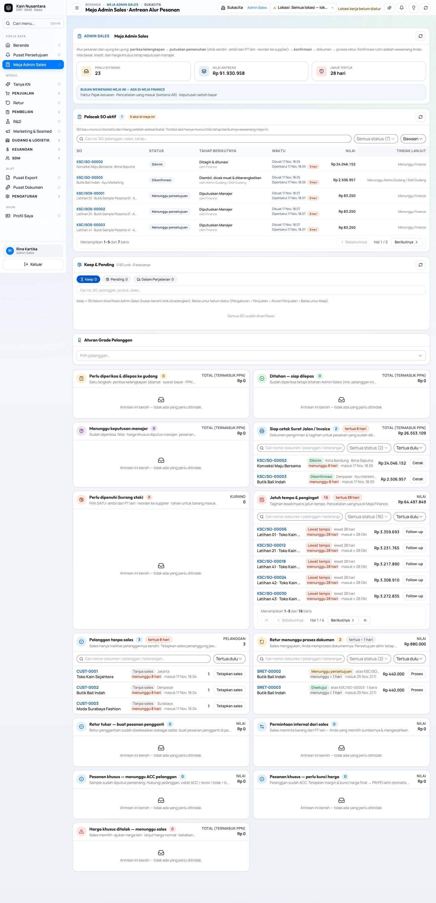

# Audit layar Meja — 25 Nov 2026

Permintaan pemilik (25 Nov): *"cek semua menu meja… UI-nya sangat bertumpuk, di-klik tidak muncul detailnya padahal di
preview infonya terpotong, sebaiknya bisa langsung dikerjakan di sini tanpa pindah ke halaman yang dituju, konten tidak
lengkap, font tidak konsisten (bold dan besar), terlalu banyak duplikasi — ada 3 tulisan Meja Admin Sales."*

Cara audit:
- aplikasi dijalankan dengan data acuan lokal, tujuh meja desktop dibuka dengan akun perannya masing-masing (lebar 1440 px), ditambah tiga layar HP (390 px);
- baris dan tombol diklik dengan Playwright, dan ukuran/tebal huruf diukur dari layar yang tampil;
- kode dibaca di `HEAD db0a20f`.

Bahan pendukung:
- Lampiran A: audit kode lengkap per meja, dengan `berkas:baris`.
- Lampiran B: log uji klik dan huruf.
- Folder `tangkapan/`: tangkapan layar.

Belum ada kode yang diubah.

## 1. Ringkasan

| # | Keluhan pemilik | Yang terjadi sekarang | Bukti |
|---|---|---|---|
| 1 | **Bertumpuk** | Sebelum baris pekerjaan pertama, layar sudah terisi oleh: kepala meja, paragraf penjelasan, 3 kartu angka, kotak "paling lama menunggu", kotak "bukan wewenang meja ini", dan tabel Pelacak SO. Kartu antrean yang kosong tetap setinggi kartu sebelahnya. Akibatnya Meja Admin Sales setinggi **3,3 layar**, Keuangan 2,5, Meja Saya manajer 2,1, HP sales 4,5. Di Meja Admin Sales (data acuan), 9 dari 13 kartu antrean kosong. | `tangkapan/01`, `02`, `03`, `09`; Lampiran A §3.2-3 |
| 2 | **Klik tidak membuka rincian** | **Di semua meja desktop, baris dan nomor dokumen tidak bisa diklik**, walaupun nomornya biru seperti tautan dan barisnya berubah warna saat disorot. Kartu angka juga memakai kursor tangan dan terangkat saat disorot, tetapi tidak berbuat apa-apa. Satu-satunya yang membuka rincian: meja HP MD. | Lampiran B ("tidak ada nomor dokumen yang bisa diklik"); `DeskQueueCard.jsx:163-169` |
| 3 | **Harus pindah halaman** | Dari 17 tombol aksi yang diuji, **13 memindahkan pengguna ke menu lain**, 3 bekerja di tempat, dan 1 tidak berbuat apa-apa. Beberapa bahkan berhenti di daftar tanpa membuka dokumennya: **Cetak**, **Follow-up**, dan **Putuskan** mendarat di daftar Pesanan; **Proses** di daftar Retur; **Tinjau** di daftar Pesanan Sample. Saat kembali ke meja, isian cari, saringan, dan halaman kartu hilang. Yang sudah dikerjakan di tempat baru: Terima pembayaran (pop-up), Terbitkan faktur pajak, Setujui bayar sample. Meja Saya, MD, dan Gudang tidak punya satu pun aksi di tempat. | `tangkapan/11`, `13`; Lampiran B |
| 4 | **Aksi berbahaya tanpa konfirmasi** | **Terbitkan Faktur Pajak** dan **Setujui Bayar** sample langsung jalan sekali klik, tanpa pratinjau atau konfirmasi. Saat audit, satu klik uji langsung menerbitkan `KSC/FKT-00001` dan menyetujui bayar `KSC/SOS-00001` (di basis data uji lokal). Di daftar Pesanan Sample, setujui bayar wajib cek uang masuk dulu; di meja tidak. | Lampiran B; `FinanceDesk.jsx:174-186`; `SampleAdminDesk.jsx:36-45` |
| 5 | **Teks terpotong** | Per meja ada 10–24 teks terpotong (nama pelanggan, keterangan, "Giliran Anda — Setujui pesana…"). Sekitar separuhnya tanpa tooltip, dan tooltip pun tidak bekerja di HP. Server juga ikut memotong teks (alasan 70–80 huruf, barang kurang hanya 2 baris, item sample 3). | Lampiran B; Lampiran A §3.2-6 |
| 6 | **Isi kurang / menyesatkan** | Tidak ada nama PT di baris saat mode "Semua PT". Batas cadangan stok tidak tampil. "masuk ±" ditebak bila waktunya kosong. Pesanan sample disebut "Diputuskan Manajer" tetapi pemiliknya Finance. Pesanan sample yang sama muncul sebagai "giliran" di tiga meja sekaligus (Manajer, Finance, Admin Sample). | `tangkapan/03`; Lampiran A §3.2-10 |
| 7 | **Huruf tidak konsisten** | Satu meja memakai **13–19 kombinasi ukuran/tebal** (9 sampai 15 px; tebal 400/600/700; ada 10,5 / 11,5 / 12,5 px). Ada tiga sistem huruf yang bercampur. Judul kartu sama tebal dan besar dengan judul halaman. Dalam satu baris ada lima unsur tebal. Pilihan dropdown "Semua status" lebih besar daripada kotak cari di sebelahnya. Banyak teks di bawah 12 px, padahal standar minimal 12 px. | Lampiran B; Lampiran A §3.2-7 |
| 8 | **Duplikasi** | "Meja Admin Sales" tertulis di sidebar, breadcrumb, judul halaman, dan kepala meja; "Perlu Tindakan" 4 kali; ada 4 tombol muat ulang di satu meja. Pekerjaan yang sama tampil 2–3 kali: Pelacak SO + Keep + antrean "Perlu diperiksa"; "Uang masuk perlu dicatat" dan "Piutang lewat jatuh tempo" berisi 5 pesanan yang sama; "Giliran saya" dan "Pesanan menunggu ACC" berisi 5 pesanan yang sama. Satu meja punya dua nama: Meja Gudang/Meja Admin Gudang, Meja Saya/Meja Manajer, Meja Sample/Meja Admin Sample. | `tangkapan/01`, `02`, `03` |

## 2. Per meja (singkat — rincian di Lampiran A §2)

- **Meja Admin Sales.**
  - Urutannya: Pelacak SO, lalu Keep & Pending (tanpa paginasi), lalu form "Aturan Grade Pelanggan" (alat cari, bukan antrean), baru 13 kartu antrean.
  - Tombol "Cetak" hanya membuka daftar Pesanan.
  - Pop-up periksa/pemenuhan masih buatan sendiri, belum memakai pop-up standar.
- **Keuangan › Perlu Tindakan.**
  - Sudah menyembunyikan kartu kosong dan mengurutkan yang paling mendesak. Ini yang terbaik di antara semua meja.
  - Masih ada isi ganda antar kartu dan Pelacak SO.
  - "Terbitkan" faktur pajak tanpa konfirmasi.
  - Breadcrumb 5 tingkat.
- **Meja Saya** (manajer/sales/dst.):
  - nol aksi di tempat;
  - "Giliran saya" menggandakan antrean di bawahnya;
  - tombol "Buka" membawa ke Pusat Persetujuan.
- **Meja MD.**
  - Ada Pelacak SO, padahal MD tidak menindak SO ("0 aksi di meja ini").
  - 8 dari 9 kartu kosong.
- **Meja Gudang.**
  - Semua aksi pindah ke menu Pengiriman, Barang Keluar, atau Inspeksi.
  - Tombol "Buka tugas gudang" di Pelacak SO tidak berbuat apa-apa: URL dan layar tetap sama.
- **Meja Sample.**
  - "Setujui Bayar" sekali klik.
  - Pelacak SO kosong tetap mengambil satu kartu.
  - Kartu kosong "Siap diteruskan ke gudang" setinggi 5 baris.
- **HP Admin Sales.**
  - Kartu kosong sudah dilipat: polanya lebih baik daripada desktop.
  - Teks dipotong tanpa cara melihat utuh.
- **HP Sales** (4,5 layar): berisi Titipan, Papan PO Custom, pesanan menunggu ACC, Performa, Komisi, Pesanan Terbaru, Keep & Pending, Penagihan, dan Pelanggan. Terlalu panjang untuk layar pertama.
- **HP MD.** Barisnya bisa dibuka ke rincian. **Pola ini yang patut ditiru.**

## 3. Arah perbaikan yang diusulkan

Semua bahan sudah ada di kode; perbaikan ini bukan membangun dari nol. Lampiran A §3.3 memetakan komponen rincian dan aksi yang
sudah ada untuk setiap jenis antrean.

1. **Klik baris = rincian di tempat.**
   - Satu daftar "jenis dokumen → panel rincian" dipanggil oleh kartu antrean bersama (`DeskQueueCard`). Contoh: SO memakai `OrderDetailPanel`, persetujuan memakai `ApprovalDecisionModal`, PR/PO/makloon/inspeksi/retur memakai panel rinciannya masing-masing, pelanggan memakai kartu pelanggan.
   - Teks utuh terbaca di sini, dan tombol aksinya ada di panel yang sama.
   - "Buka layar penuh" menjadi tautan sekunder.
   - Bentuknya **panel tetap di kanan** (`DetailDrawer`, daftar tetap terlihat) atau **pop-up** (`DetailModal`). Lihat keputusan 1.
2. **Tombol aksi menjalankan aksinya di tempat.** Setujui/tolak, putuskan, tetapkan sales, tugaskan, dan buat pengiriman memakai pop-up yang sudah ada. Isian cari, saringan, dan halaman kartu tidak hilang.
3. **Aksi berakibat besar selalu lewat pratinjau + konfirmasi**: terbit faktur pajak, setujui bayar, lepas/teruskan ke gudang. Polanya sama dengan Meja Kredit (`askConfirm`).
4. **Layar pertama langsung pekerjaan.**
   - Kartu kosong dilipat menjadi satu baris "Bersih: …". Fungsinya sudah ada di kode (`splitDeskQueues`), hanya belum dipakai.
   - Kartu diurutkan dari yang paling mendesak.
   - Paragraf penjelasan dan kotak "bukan wewenang" dipindah ke ikon "?".
   - Kartu angka dihapus, atau dibuat bisa diklik untuk menyaring.
5. **Hilangkan duplikasi.**
   - Satu nama per meja: menu = breadcrumb = judul. Kepala meja di dalam layar dihapus.
   - Pelacak SO hanya di meja yang menindak SO, atau dipindah ke tab "Pantau".
   - Antrean yang isinya sama digabung: uang masuk vs piutang lewat tempo, giliran saya vs menunggu ACC.
   - Pesanan sample hanya menjadi "giliran" satu pemilik.
6. **Satu skala huruf.** Hanya token `fs-*` (12/13/14/16/20 px, minimal 12). Judul kartu 14 semi-tebal, nomor dokumen 13 semi-tebal, sisanya 12–13 normal. Tinggi kontrol saringan disamakan dengan kotak cari.
7. **Isi dilengkapi:**
   - PT per baris;
   - batas cadangan;
   - semua barang kurang (bukan 2 baris);
   - pelanggan & SKU di Meja Cutting;
   - waktu masuk yang nyata, bukan ditebak.

## 4. Keputusan pemilik yang dibutuhkan

Standar layar yang berlaku (`docs/blueprint/04_POLA_UI.md`) saat ini **bertentangan** dengan keluhan ini: rincian harus berupa
halaman/panel tetap tanpa pop-up melayang yang menutupi daftar, dan kartu kosong wajib tetap tampil. Standar perlu diubah dulu.

1. **Rincian di tempat:** panel tetap di kanan (daftar tetap terlihat; *usulan*) atau pop-up di tengah?
2. **Kartu kosong:** dilipat menjadi satu baris "Bersih: …" (*usulan*) atau tetap tampil?
3. **Pelacak SO, Keep & Pending, Aturan Grade:** dipindah ke tab "Pantau" di meja yang sama (*usulan*), atau dihapus dari meja?
4. **Nama meja:** satu nama per meja (*usulan*: Meja Admin Sales, Meja Keuangan, Meja Gudang, Meja Sample, Meja MD, Meja Saya), dan kepala meja di dalam layar dihapus?
5. **Aksi sekali klik** (faktur pajak, setujui bayar, lepas/teruskan ke gudang): wajib pratinjau + konfirmasi (*usulan*: ya)?
6. **Huruf minimal 12 px** untuk semua teks meja, termasuk label kolom (*usulan*: ya)?

## 5. Kaitan dengan rancangan "Lapor Bayar CBD"

Tahap baru "Bayar dicek Finance" akan tampil sebagai antrean di Meja Keuangan dan sebagai tahap di Pelacak SO. Rancangannya
sebaiknya langsung memakai pola baru di atas: klik baris membuka rincian pesanan, foto bukti, dan tombol Terima/Tolak di
tempat. Karena itu keputusan 1, 2, dan 5 di atas juga menentukan bentuk Lapor Bayar.
