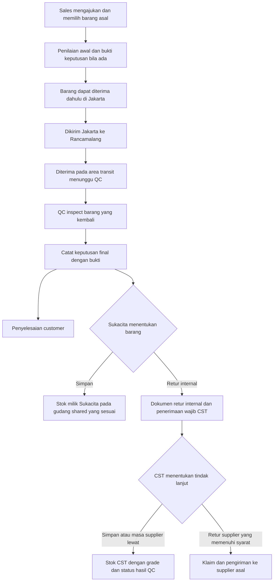

# Pemrosesan Jawaban Retur dan Flow Terkini

**ERP Kain Nussantara — Produksi IT PT Kubus Teknologi Indonesia**  
**16 Oktober 2026 · Keputusan kebutuhan setelah jawaban pemilik R-01–R-13**

Dokumen ini menjadi acuan keputusan terbaru, menggantikan status pertanyaan pada versi sebelumnya. Jawaban pemilik sudah diproses; tidak berarti fitur telah diimplementasikan. Belum ada source/konfigurasi ERP yang diubah.

## 1. Status seluruh jawaban

| Poin | Status | Keputusan/pemahaman aktif |
|---|---|---|
| R-01 | Menunggu client | Pertanyaan cutloss harus memakai contoh roll 120 yard, cacat yard 46–60: apakah customer menerima 61–120 (60 yard) dan nilai dikembalikan setara 60 yard, atau menerima dua potong 1–45 dan 61–120 (105 yard) dengan nilai dikembalikan setara 15 yard. Tidak menetapkan salah satu skenario sebagai aturan. |
| R-02 | Dijawab pemilik | Sales yang membuat Sales Retur memilih barang/roll mana dari transaksi sumber yang diretur. Identifier, qty dan satuan sumber otomatis; tidak tambah produk bebas. Rincian perlakuan potongan mengikuti hasil klarifikasi cutloss. |
| R-03 | Dijawab pemilik | Tidak menerima Barang Sisa sebagai layanan pengajuan tersendiri. Garansi adalah masa klaim 21 hari sesudah barang dikirim. Tidak membuat layanan garansi tambahan atau menyamakan Barang Sisa dengan grade BS. |
| R-04 | Menunggu client | Perbedaan qty yard pada tukar sangat mungkin; patokan pengganti dan penyelesaian selisih perlu diklarifikasi ke client. Tidak mengasumsikan jumlah roll berarti qty yard selalu sama. |
| R-05 | Menunggu client | Dasar nilai serta tagihan/refund/saldo atas selisih tukar harus ditanyakan ke client. Belum menetapkan selisih gratis, otomatis ditagih, atau harga acuan. |
| R-06 | Dijawab pemilik | Perubahan warna dan grade pengganti tidak diperbolehkan. Acuan pengganti adalah transaksi asal; penurunan grade barang yang kembali setelah QC merupakan hal berbeda. |
| R-07 | Dijawab pemilik | Barang pengganti mengikuti permintaan QC pada SO awal. Pengganti menunggu barang retur diterima dan selesai QC. QC atas barang kembali selalu berbeda dari QC roll pengganti. Pengiriman menunggu keputusan final yang berlaku. |
| R-08 | Dijawab pemilik | Customer boleh memilih refund atau saldo. Bila masih ada tagihan, nilai mengurangi tagihan terlebih dahulu; kelebihannya direfund atau menjadi saldo. Pertanyaan baru KLR-10 hanya tentang cakupan SO/tagihan lain, bukan mengulang pilihan refund/saldo. |
| R-09 | Dijawab pemilik | Foto boleh dilengkapi kemudian. Kewajiban foto mengikuti konfigurasi kebijakan. Upload tersedia sejak pengajuan; tidak mewajibkan foto untuk seluruh kasus secara hardcoded. |
| R-10 | Dijawab pemilik | CST wajib menerima retur internal bila Sukacita memutuskan mengembalikan ke CST. Sebelumnya Sukacita dapat memilih menyimpan sebagai stok milik Sukacita. Keputusan menyimpan tidak membalik pembelian internal. Penerimaan CST tidak menambahkan approval bisnis opsional yang bisa menolak aturan ini. |
| R-11 | Dijawab pemilik | QC retur saat ini hanya di Rancamalang. Retur dari Jakarta dapat diterima di Jakarta, dikirim ke Rancamalang dan ditempatkan pada area transit menunggu QC. Gudang shared dibagi kategori, bukan per entitas. Owner dapat menjadi CST setelah retur internal walau fisik tetap di area shared. Lokasi, gudang/area, status fisik/QC dan owner harus dicatat terpisah; jangan membuat gudang entitas fiktif atau perpindahan fisik fiktif. |
| R-12 | Dijawab pemilik | CST boleh memilih simpan atau retur supplier. Bila masa retur supplier lewat, disimpan sebagai stok. Stok tetap membawa kondisi/grade/hold hasil QC; bukan otomatis menjadi available. Disposal atas grade BS tetap tindakan tersendiri sesuai keputusan sebelumnya. |
| R-13 | Dijawab pemilik | Persetujuan melalui WA berlangsung di luar ERP; gunakan bukti keputusan. Keputusan tukar/kompensasi final sesudah QC inspect. Tidak membuat integrasi WA baru. Pengecualian cara verifikasi discount tanpa barang kembali perlu klarifikasi KLR-06. |

## 2. Bentuk pengajuan setelah jawaban ini

- Sales memilih SO dan item/roll dari pengiriman yang memang terkait. Artikel, warna, SKU, ID roll, qty dan satuan sumber ditampilkan otomatis. Tidak ada tambah produk bebas.
- Barang Sisa bukan layanan retur tersendiri. Garansi bukan flow baru; yang dimaksud masa klaim 21 hari. Bentuk permintaan customer tetap belum merupakan keputusan final.
- Foto dapat diunggah sejak pengajuan dan dilengkapi kemudian; kewajibannya melalui konfigurasi kebijakan. Alasan memakai satu sumber master, tanpa dua input alasan yang bersaing.
- Tahap pada daftar berupa filter. Semua aktivitas mengikuti hak akses yang dapat dikonfigurasi. Larangan Sales melihat grade tetap berlaku meskipun pemeriksaan/penentuan pengganti membutuhkan grade di belakang layar.
- Permintaan tukar tetap artikel, warna dan grade yang sama dengan transaksi asal. Jika barang yang kembali diturunkan gradenya setelah QC, itu tidak mengubah grade yang menjadi hak pengganti secara diam-diam.

## 3. Flow fisik retur dari Jakarta ke QC Rancamalang

Diagram ini berlaku untuk cabang yang mengembalikan barang secara fisik. Discount yang barangnya tetap di customer masih memerlukan jawaban client tentang cara memenuhi syarat pemeriksaan sebelum keputusan final; tidak dibuat receiving/QC fiktif.

### Keberadaan fisik harus mengikuti kejadian aktual

| Kejadian | Posisi yang boleh ditampilkan | Owner dan ketersediaan |
|---|---|---|
| Diterima Jakarta | Lokasi Jakarta, gudang/area penerimaan aktual | Bukan stok bebas sebelum proses selesai; owner mengikuti dokumen sumber/penerimaan |
| Berangkat ke Bandung | Dalam perjalanan Jakarta→Rancamalang | Belum dianggap sudah tiba di Rancamalang; owner tidak berubah hanya karena pindah lokasi |
| Diterima untuk QC | Rancamalang, gudang operasional yang menaungi area, **area transit menunggu QC** dan alamat aktualnya | Masih ditahan/karantina; owner dapat Sukacita meskipun area shared |
| Sedang/sudah diperiksa | Posisi area QC aktual sampai ada serah terima berikutnya | Selesai QC belum otomatis available; menunggu keputusan/tindak lanjut yang relevan |
| Sukacita memilih simpan | Tetap di area QC sampai putaway/serah ke penyimpanan benar-benar dilakukan | Owner tetap Sukacita; gudang penyimpanan dipilih menurut kategori/rules |
| Sukacita memilih retur ke CST | Fisik dapat tetap di tempat yang sama di Rancamalang | Owner menjadi CST melalui penyelesaian retur internal yang sah; tidak perlu pindah gudang fiktif |
| CST memilih simpan | Pindah ke alamat penyimpanan shared sesuai realisasi | Owner CST; grade/hold tetap mengikuti hasil dan keputusan yang berlaku |
| CST kirim supplier | Masuk perjalanan supplier hanya ketika benar-benar diberangkatkan | Dokumen/aset dan klaim tetap mengikuti lifecycle supplier, bukan hilang karena tombol keputusan |

**Area QC adalah area fisik/transit, bukan entitas pemilik dan tidak wajib sebuah gudang mandiri.** Master harus menunjuk gudang operasional aktual yang menaungi area itu. Lokasi Rancamalang tidak dibagi menjadi Gudang Sukacita/Kanda/CST jika pembagian fisiknya memang kategori/shared. Aturan kategori dapat mencakup satu atau beberapa kategori sesuai konfigurasi yang sah.

Tidak ditetapkan nama induk gudang, zona atau rak baru yang belum diberikan. Tampilan roll minimal membedakan lokasi/site, gudang dan area/alamat fisik, status QC, owner, identitas serta qty/unit. Itu mencegah roll milik CST seolah otomatis berada di gudang bernama CST.

## 4. Tukar dan penyelesaian nilai

1. Barang pengganti menunggu barang retur diterima dan selesai QC. Keputusan tukar/kompensasi final dicatat sesudah pemeriksaan dengan bukti keputusan yang diperoleh di luar ERP.
2. Pengganti mengikuti artikel, warna dan grade transaksi asal. Hak memilih/alokasi mengikuti konfigurasi akses, bukan Sales mengetik produk bebas.
3. Jika SO awal meminta QC sebelum kirim, roll pengganti juga diperiksa. Jika SO awal tidak meminta QC, tidak ditambahkan kewajiban QC pengganti baru dari asumsi. QC mutu tetap berbeda dari scan validasi muatan.
4. Pengganti kemudian mengikuti alokasi/pemenuhan, picking, validasi muat, dokumen pengiriman dan bukti penerimaan customer yang tertaut pada kasus retur. Qty patokan dan selisih nilai belum difinalkan sampai client menjawab.
5. Nilai kompensasi yang telah disetujui mengurangi tagihan lebih dahulu. Sisa hak customer dapat dipilih sebagai refund atau saldo. Pertanyaan yang masih diperlukan hanya cakupan tagihan lain dan dasar nilai yang belum disepakati; pilihan customer tidak ditanyakan ulang.

## 5. Sukacita dan CST pada area shared

Keputusan pasca-QC mempunyai dua tingkat yang jelas:

- **Sukacita:** menyimpan sebagai stok miliknya sendiri atau mengembalikan transaksi internal ke CST. Jika menyimpan, pembelian internal tidak dibalik hanya karena customer retur.
- **CST:** wajib menerima cabang retur internal yang diputuskan Sukacita. Setelah itu CST memilih simpan atau retur supplier. Bila masa retur supplier sudah lewat, disimpan sebagai stok menurut arahan pemilik.

Kewajiban menerima secara bisnis tidak menghapus kebutuhan mencocokkan identitas, qty dan dokumen atau mencatat selisih fisik. Penerimaan/konfirmasi operasional bukan izin menolak kebijakan penerimaan yang sudah diputuskan. Penyelesaian owner dapat berlangsung pada lokasi fisik shared yang sama, dengan dokumen internal yang sesuai.

Kata **stok** tidak otomatis berarti layak jual: hasil QC, grade, karantina dan aturan disposal yang telah disepakati tetap dibawa. Grade BS tidak otomatis menjadi available hanya karena masa klaim supplier lewat. Supplier kedaluwarsa juga tidak menggugurkan klaim customer yang sah secara otomatis.

## 6. Persetujuan dan bukti

WA tetap di luar sistem. ERP mencatat keputusan dan bukti yang relevan, identitas pencatat, tanggal, bagian/qty yang disetujui dan tindak lanjutnya. Tidak dibuat integrasi WA baru sebagai syarat flow.

Izin awal mengembalikan untuk diperiksa berbeda dari keputusan tukar/kompensasi final. Untuk barang yang kembali, keputusan final sesudah QC inspect. Foto bukti boleh menyusul sesuai kebijakan; ini tidak berarti keputusan final boleh dibuat sebelum syarat pemeriksaan terpenuhi. Cabang discount tanpa fisik kembali tetap menunggu cara pemeriksaan yang disetujui client.

## 7. Kaitan dengan kode yang sudah diperiksa

Acuan: snapshot main `64d81f29577dae4daa86ddc64689dec7243804f2`, bukan klaim sudah mengambil pembaruan remote baru atau implementasi telah selesai.

- Fondasi site/gudang, area berfungsi QC, rule kategori dan shared/dedicated sudah ada. [Profil lokasi/gudang](https://github.com/pandeyoga/KNHOST/blob/64d81f29577dae4daa86ddc64689dec7243804f2/backend/services/warehouse_profile_service.py#L1), [pagar area QC](https://github.com/pandeyoga/KNHOST/blob/64d81f29577dae4daa86ddc64689dec7243804f2/backend/services/placement_rules.py#L165).
- Relokasi retur existing langsung mengganti gudang roll dan mencatat keluar/masuk dalam satu aksi. Itu belum mewakili keberangkatan, barang dalam perjalanan, penerimaan Jakarta–Rancamalang dan alamat area QC yang baru dijelaskan. [Relokasi retur](https://github.com/pandeyoga/KNHOST/blob/64d81f29577dae4daa86ddc64689dec7243804f2/backend/services/return_service.py#L1656).
- Retur internal existing sudah dapat membuat tugas dengan gudang asal dan tujuan yang sama. Ini fondasi untuk owner berbeda pada tempat shared yang sama, tetapi tetap perlu penyelarasan urutan keputusan/qty dan dokumen. [Tugas retur internal](https://github.com/pandeyoga/KNHOST/blob/64d81f29577dae4daa86ddc64689dec7243804f2/backend/services/interco_return_service.py#L615).
- Temuan penggantian, sumber PO dan pemeriksaan halaman pada dokumen 07 masih menjadi catatan implementasi yang harus diselesaikan; jawaban bisnis tidak membuktikan source sudah memperbaikinya.

## 8. Pertanyaan client yang masih aktif

[Daftar siap untuk pembahasan client](09_Pertanyaan_Client_Retur_dan_Pendukung.md) memuat 11 topik retur dan tiga topik pendukung yang telah tertunda sebelumnya: LOT, formula inspect, cutoff pembayaran internal. Pertanyaan pendukung disajikan terpisah agar pembahasan retur tetap fokus. Tidak mengulang pertanyaan nama staf, hak akses, warna/grade, QC pengganti, pilihan refund/saldo, foto wajib atau keputusan CST yang sudah dijawab.
