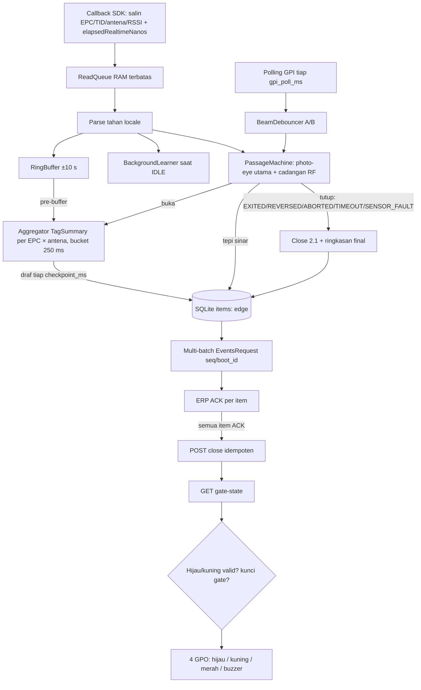

# Arsitektur dan kontrak implementasi (0.5.0-lab, kontrak 2.1.0)

ERP Kain Nussantara · PT Kubus Teknologi Indonesia

## Alur utama

## Pembagian kode

| File | Tanggung jawab |
|---|---|
| `MainActivity` | Dashboard, provisioning, kontrol layanan, simulasi skenario gate, uji meja K-RFID-03, ekspor |
| `AgentService` | Loop kontrol (GPI, kuras bacaan, pipeline, indikator), Store SQLite, transport multi-batch, galat, gate-state, telemetry |
| `Reader` | Batas SDK Chainway: init, antena, `RadioSetup.Port` (set/baca radio), callback salin-saja, GPI + statistik latensi, GPO, cek layanan bawaan |
| `Bench` | Mode diagnostik uji meja K-RFID-03 (9 butir) |
| `Journal` | SQLite skema 2: items/batches/passages/bench, migrasi 1→2, ACK per jenis item |
| `Api` | HTTPS + simulator ERP 2.1; galat terstruktur `detail.code`; sinkron jam tiap respons |
| `Config` | Validasi DeviceConfig 2.1 + ekstensi `kn-u300-v1` (radio, posisi antena, tuning) |
| `DecisionPolicy` | Validasi ketat hijau (`manifest_full`/`document_session`) dan kuning (REVIEW) |
| `Telemetry` | Payload telemetry + penghitung 0.5 |
| `Provision` | Endpoint, Keystore, PIN, opsi boot |
| `core/*` | Kelas murni teruji host: `PassageMachine`, `GatePipeline`, `Aggregator`, `BackgroundLearner`, `RingBuffer`, `ReadQueue`, `BeamDebouncer`, `Parse`, `Batcher`, `Envelope`, `ErrorPolicy`, `ClockSync`, `Indicator`, `RadioSetup`, `PortProbe`, `Safety` |

Capture tidak menjalankan HTTP. Callback SDK tidak memegang lock global, tidak menulis SQLite, tidak mem-parse
(AUD-MW-24). Thread kontrol menulis SQLite hanya saat ada transisi (buka/tepi/tutup) dan checkpoint draf 1×/s.

## Penyimpanan dan pemulihan

- Database produksi dan simulasi terpisah (`production-v1.db` / `simulation-v1.db`, skema 2).
- `passages`: meta saat dibuka (versi config, gate, basis, arah, profil, `sensor_mode`, `open_reason`, `window_start`,
  `boot_id`), kelengkapan, body close, idempotency key, status, keputusan, `close_attempts`/`close_due`.
- `items`: `event` (0.4) / `summary` / `edge`, status `draft → pending → acked | quarantined | rejected`, `batch`, `bytes`.
- `batches`: body persis untuk retry + `seq`/`boot`. `state`: config, latch, eligibility, `seq:<boot_id>`.
- `audit`, `bench`. Migrasi 0.4 → 0.5: `events` → `items` + `events_v1_archive` (tanpa menghapus).
- Restart: OPEN → INTERRUPTED; draf ringkasan menjadi pending; close `ABORTED` tidak lengkap. Penolakan/karantina
  tidak dihapus.
- Lintasan yang dibuka saat offline = `backfill` (tidak pernah hijau/kuning). Offline di tengah lintasan → lintasan
  kehilangan eligibility; request persisten tetap memakai ID/body asli.

## Endpoint yang dipakai

Base: origin ERP + `/api/rfid/v2`, autentikasi `X-Device-Key`.

| Endpoint | Fungsi |
|---|---|
| GET /device/config | DeviceConfig 2.1 (profil berversi, `passage_parameters`) |
| POST /events | `events` (0.4) dan/atau `tag_summaries[]` (≤ 500) dan/atau `gpi_edges[]` (≤ 200); `seq`, `boot_id`, `sent_at`; ACK `event_acks`/`summary_acks`/`edge_acks` |
| POST /passages/{id}/close | Close 2.1 idempoten (`open_reason`, `close_reason`, `window_start`, `beam_times`, `pre_buffer_ms`, `tail_ms`, `observed_*_count`, `sensor_health`, `boot_id`) |
| GET /device/gate-state | Kunci gate (satu per gate) + keputusan lintasan |
| POST /device/telemetry | Radio, transport, antrean, jam, platform_health 0.5 |

Pengakuan supervisor tidak memakai device key; agent mengikuti gate-state.

## Pengaman keputusan

**Hijau** memerlukan semua: lintasan terakhir sudah ditutup, capture lengkap, semua item ACK *accepted/duplicate*
(tanpa karantina/tolak), mode live, belum pernah offline, keputusan final, `allow_live_signal`, tidak terkunci (gate
& keputusan), gate/config/basis sama dengan profil, jam server valid & segar, belum kedaluwarsa, verdict GREEN, basis
`manifest_full` (sisa 0) atau `document_session` (sisa ≥ 0 bilangan bulat), `missing`/`extra`/`unknown` = 0,
`observed_unique` = `matched` > 0. Keputusan yang sama tidak memperpanjang lampu.
**Kuning** memerlukan konteks/kesegaran yang sama, verdict REVIEW, tanpa kunci; ditahan `yellow_hold_ms`.
**Merah** mengikuti `latched` gate-state (selalu menang); kunci baru menyalakan buzzer `buzzer_ms`.

Jam server dipetakan ke waktu monotonik dari setiap respons ber-`server_time` (RTT ≤ 2 s, koreksi ½ RTT); referensi
> 120 s dianggap basi → tidak ada izin sinyal.

## Parameter profil

Lihat [08 §5](08_PERUBAHAN_050.md#5-ekstensi-profil-kn-u300-v1-hardware_profileparameters) dan
`docs/device-config.template.json`. Semua bawaan = titik awal kalibrasi.

| Gate `sensor_bindings` | Mode agent |
|---|---|
| `direction in/out` + `a`,`b` (GPI1–GPI4, berbeda), `active_state` 0/1, `mode through_beam` | `one_way_beam` — photo-eye utama + cadangan RF |
| `direction in/out` + kosong | `rf_only` — logika RF saja (`sensor_health absent`) |
| `direction bidirectional` + `a`,`b` | `legacy_bidirectional` — perilaku arah 0.4 (`sequence_window_ms`, idle close) |
