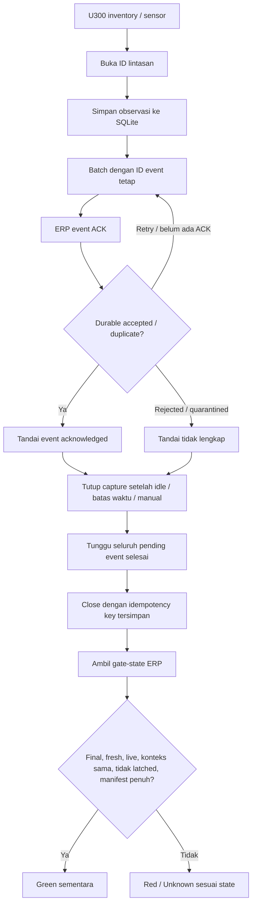

# Arsitektur dan kontrak implementasi

ERP Kain Nussantara · PT Kubus Teknologi Indonesia

## Alur utama

## Pembagian kode

| File | Tanggung jawab |
|---|---|
| MainActivity | Dashboard, provisioning, kontrol layanan, simulasi, ekspor diagnosis |
| AgentService | Lintasan, koordinasi capture/transport, recovery, telemetry, keputusan indikator |
| Reader | Batas integrasi SDK Chainway; init, inventory, antena, pembacaan GPIO, output |
| Journal | SQLite, transaksi batch, ACK, histori, audit |
| Api | HTTPS dan simulator respons; timeout, status HTTP, Retry-After |
| Config | Validasi versi/profil, gate, sensor, indikator, limits dan policies |
| Provision | Identitas endpoint, Keystore, PIN dan pilihan boot |
| core/Safety | Kebijakan pengaman tanpa ketergantungan Android, dapat diuji di host |

Capture tidak menjalankan HTTP. Worker jaringan terpisah mengirim data yang sudah tersimpan. Callback vendor menyalin nilai EPC/TID/antena/RSSI sebelum menulis observasi. Panggilan stop radio dilakukan di luar lock lintasan untuk menghindari menunggu callback yang sedang menyimpan data.

## Penyimpanan dan pemulihan

- Database produksi dan simulasi terpisah.
- `passages`: konteks saat pembukaan, kelengkapan, request close, idempotency key, status dan keputusan.
- `events`: body observasi dan status `pending/acked/quarantined`.
- `batches`: body request yang persis sama untuk pengiriman ulang; tidak membuat ID event baru saat timeout.
- `state`: config, identitas, eligibility clearance, latch dan keputusan yang sudah pernah digunakan untuk sinyal.
- `audit`: jejak pemeliharaan/lintasan tanpa credential.
- Restart mengubah OPEN menjadi INTERRUPTED. Event tetap dikirim untuk rekonsiliasi; close menyatakan capture tidak lengkap. Penolakan/karantina tidak dihapus dari penyimpanan.
- Saat koneksi terputus pada lintasan live, lintasan tersebut langsung kehilangan eligibility sinyal lokal. Request live yang sudah persisten tetap memakai identitas/body aslinya pada retry agar tidak merusak idempotensi. Lintasan baru yang dibuka offline memakai `backfill`.

## Endpoint yang dipakai

Base: origin ERP + `/api/rfid/v2`, autentikasi `X-Device-Key`.

| Endpoint | Fungsi |
|---|---|
| GET /device/config | Identitas, profil hardware, policy, gate dan batas antrean |
| POST /events | Mengirim observasi; ACK durable tidak sama dengan izin pengiriman |
| POST /passages/{id}/close | Close idempotent; respons berupa GateDecision |
| GET /device/gate-state | State latch otoritatif dan keputusan untuk lintasan |
| POST /device/telemetry | Radio, koneksi, antrean, ruang bebas, waktu dan status platform |

Endpoint acknowledge supervisor sengaja tidak dipanggil memakai device key. Agent mengikuti gate-state setelah persetujuan dilakukan di ERP.

## Pengaman keputusan

Green memerlukan seluruh kondisi: current passage sudah ditutup, capture lengkap, semua event acknowledged, mode live, belum pernah offline pada lintasan itu, keputusan final, allow_live_signal, tidak latched, gate/config/completion basis sama, server time valid, belum expired, `manifest_full`, observed_unique positif dan missing/extra/unknown/pending nol. Keputusan yang sama tidak dapat memperpanjang interval green melalui polling ulang. Timer menggunakan waktu monotonik.

Jam server dipetakan ke waktu monotonik lokal setelah respons konfigurasi dengan round-trip kurang dari dua detik. Jika referensi waktu sudah terlalu lama, clearance ditolak. Keputusan ERP tetap menjadi sumber kebenaran bisnis; agent tidak mengubah stock, reserve, SO, SJ, atau kepemilikan barang secara lokal.

## Parameter ekstensi profil

Kontrak mengizinkan object parameter bebas. Implementasi ini menetapkan ekstensi `kn-u300-v1`; ekstensi ini harus disamakan dengan penyedia konfigurasi ERP.

| Parameter | Arti |
|---|---|
| hardware_profile.parameters.agent_profile | Harus `kn-u300-v1` |
| commissioned | True hanya setelah pemeriksaan perangkat dan wiring |
| expected_region_code | Nilai SDK hasil commissioning; diverifikasi, tidak ditebak aplikasi |
| expected_antenna_power_dbm | Object ID antena `1`–`8` → power yang sudah dikonfigurasi dan diuji |
| max_passage_milliseconds | Batas lintasan, default 30000; minimal idle timeout, maksimal 300000 |
| gate.sensor_bindings.a / b | Nama input SDK GPI1–GPI4; A→B berarti out, B→A berarti in |
| active_state / debounce_ms / sequence_window_ms | Polaritas input, debounce, jendela urutan; wajib diuji terhadap sensor fisik |
| gate.indicators.enabled | Mengizinkan adapter output; false pada contoh awal |
| red_output / green_output | Output berbeda, nomor 1–4 |
| active_high | Versi ini mendukung true saja; tipe relay dan rating listrik diverifikasi terpisah |

Batas lintasan versi ini memakai idle timeout, batas durasi, atau close manual. Sensor A/B menyediakan bukti arah dan aktivitas. Belum ada driver barrier otomatis, output Wiegand, atau dukungan beberapa gate paralel.
